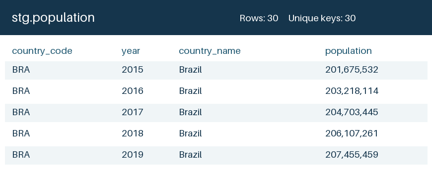

# ДЗ-1. Численность населения по данным Всемирного банка

ETL-пайплайн загружает в PostgreSQL оценки численности населения Бразилии, Китая и Индии за 2015–2024 годы. По этой таблице можно сравнивать население трёх стран на одну дату и считать изменение за год

## Источник

Источник - публичный World Bank Indicators REST API v2, база World Development Indicators (код 2), Показатель `SP.POP.TOTL` измеряет численность населения в людях. API выбран за исторические данные с единым определением показателя и стабильный ключ «страна, год». Вложенные объекты и постраничная выдача позволяют показать оба этапа обработки на небольшой выборке. [Запрос к REST API](https://api.worldbank.org/v2/country/BRA;CHN;IND/indicator/SP.POP.TOTL?source=2&date=2015:2024&format=json&per_page=7&page=1)

API возвращает номер страницы, общее число страниц и список наблюдений. Сокращённый пример ответа:

```json
[
  {"page": 1, "pages": 5, "per_page": 7, "total": 30},
  [{
    "indicator": {"id": "SP.POP.TOTL", "value": "Population, total"},
    "country": {"id": "BR", "value": "Brazil"},
    "countryiso3code": "BRA", "date": "2024", "value": 211998573
  }]
]
```

Поля, которые попадают в таблицу stg.population:

| Поле API | Тип в JSON | Поле в PostgreSQL | Тип в БД |
| --- | --- | --- | --- |
| countryiso3code | string | country_code | text |
| date | string | year | smallint |
| country.value | string | country_name | text |
| value | number или null | population | bigint |


## Как устроена загрузка

World Bank API → Jupyter Notebook → PostgreSQL (`stg.population`)

[Ноутбук](notebooks/etl.ipynb) читает 5 страниц API, переводит год в целое число и проверяет все 30 пар «страна, год». При пропуске значения или повторе пары загрузка останавливается до записи в БД. Первичный ключ таблицы — `(country_code, year)`. Если оценка изменилась, повторный запуск обновит строку

## Как запустить

Нужен Git, Python 3.11–3.14 и запущенный Docker с Compose

```bash
git clone https://github.com/TereshinDaniil/tereshin-hse-de-hw-1.git
cd tereshin-hse-de-hw-1
bash scripts/run.sh
```

Скрипт создаёт `.env` с паролем, поднимает PostgreSQL, устанавливает зависимости в `.venv` и выполняет ноутбук дважды. Проверить число строк можно из папки:

```bash
docker compose exec -T postgres sh -c 'psql -U "$POSTGRES_USER" -d "$POSTGRES_DB" -c "SELECT COUNT(*) FROM stg.population;"'
```


## Результат

После второго запуска в таблице осталось 30 строк. В журнале загрузки — 0 вставленных или обновлённых записей. Вывод последней ячейки после запуска:

```text
stg.population | rows: 30 | unique keys: 30
country_code  year   country_name     population
BRA           2015   Brazil          201,675,532
BRA           2016   Brazil          203,218,114
BRA           2017   Brazil          204,703,445
BRA           2018   Brazil          206,107,261
BRA           2019   Brazil          207,455,459
```



## Что можно улучшить?

Сейчас таблица хранит последнюю опубликованную оценку. Для анализа пересмотров можно сохранять предыдущие значения и дату версии из поля `lastupdated` API. При расширении на десятки показателей стоит включить код показателя в первичный ключ и добавить отчёт о полноте по каждой стране